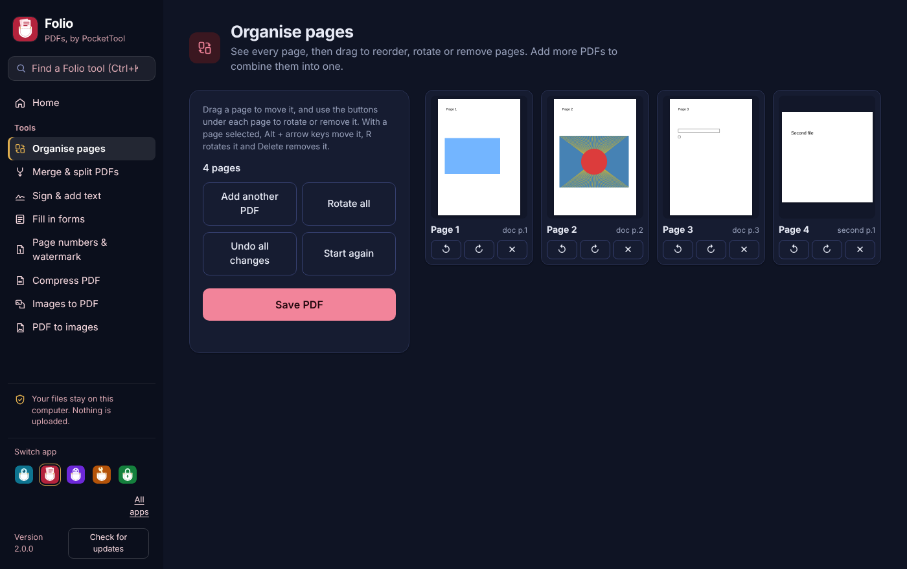
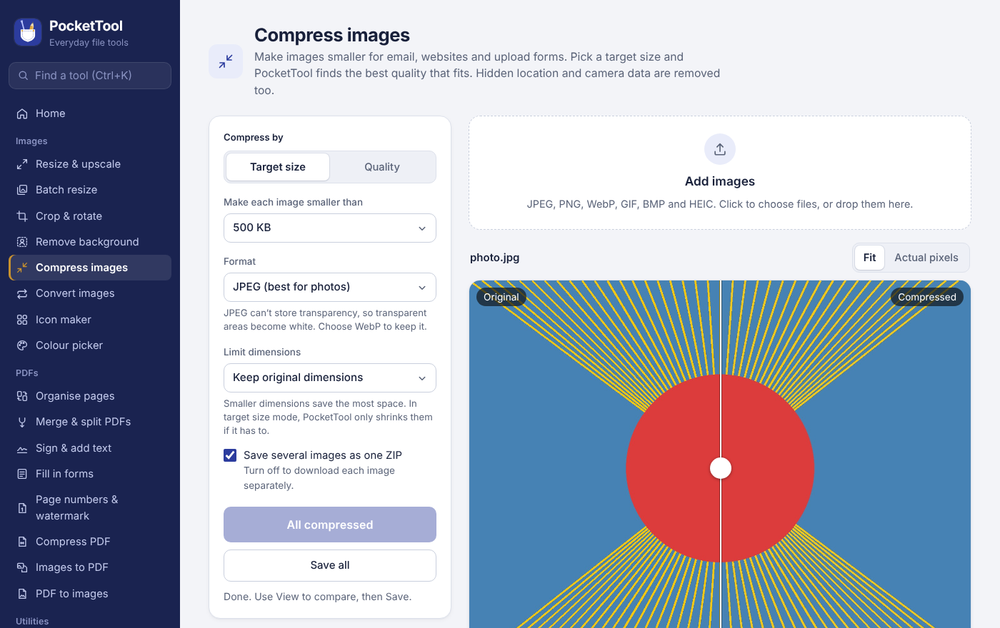
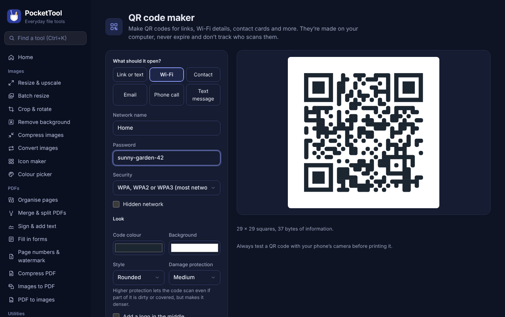

<p align="center"></p>

<h1 align="center">PocketTool</h1>

<p align="center">Everyday file tools that run on your computer.<br>Resize and compress images, sign and organise PDFs, trim and compress videos, make QR codes and more, with nothing uploaded.</p>

<p align="center"></p>

## What it does

Drop any file on the home screen and PocketTool suggests what to do with it, or pick a tool from the sidebar.

| Images | PDFs | Video & audio | Everyday utilities |
| --- | --- | --- | --- |
| **Resize & upscale**, including AI upscaling to 2× or 4× | **Organise pages**: drag to reorder, rotate or remove | **Trim** videos and audio, instantly or frame-exact | **QR code maker** for links, Wi-Fi, contacts and more |
| **Batch resize** a whole folder at once | **Merge & split** PDFs | **Compress video** by quality or to a size like 25 MB | **Spreadsheet converter**: Excel, CSV, JSON, Markdown |
| **Crop & rotate**, with straightening | **Sign & add text**: draw, type or upload a signature | **Convert** to MP4, WebM, MP3, M4A or WAV | **Password generator**, including passphrases |
| **Remove background** with AI (BiRefNet), with edge clean-up and touch-up | **Fill in forms** | **Video to GIF** | **Word counter** with post-length limits |
| **Compress** to a target size, like "under 500 KB" | **Page numbers & watermarks** | **Extract audio** from a video | **Date calculator** with UK bank holidays |
| **Convert** between JPEG, PNG, WebP, HEIC and more | **Compress PDF** |  |  |
| **Icon maker** for favicons and app icons | **Images to PDF** and **PDF to images** |  |  |
| **Colour picker** with palettes and contrast checks |  |  |  |

**Remove hidden data** strips location, camera details, author names and editing history from photos and PDFs before you share them, and shows you exactly what it removed.

<p align="center">
  
  
  
  
</p>

## Private by design

Everything happens on your computer. Your files are never uploaded, there are no accounts, and there's no tracking. The desktop app includes its AI models and libraries (which makes the installer about 1 GB), so once it's installed it works without the internet. The only optional connection is to GOV.UK, to check for newly announced bank holidays.

## Download

Get the latest version from the [Releases page](../../releases):

- **Windows**: `PocketTool-Setup-x.y.z.exe` installs it with Start menu and desktop shortcuts. `PocketTool-x.y.z-portable.exe` runs without installing.
- **Linux** (including Bazzite and Steam Deck): `PocketTool-x.y.z.AppImage`. Open it with [Gear Lever](https://flathub.org/apps/it.mijorus.gearlever) to add it to your app menu, or mark it as executable and double-click it.

The first time you run it on Windows you may see "Windows protected your PC", because the app isn't digitally signed. Click **More info**, then **Run anyway**.

## Updates

Select **Check for updates** at the bottom of the sidebar (or **Help > Check for updates…** in the desktop app). PocketTool compares your version with the latest release on GitHub, shows what's new, and offers the right download for your computer. Your settings are kept when you install a new version. You can also switch on an automatic check once a day; it only asks GitHub for the latest version number.

## Use it in a web browser

Open `app/index.html` in Chrome or Edge. Everything works the same, except that libraries and AI models are downloaded from the internet the first time each tool needs them.

## Build it yourself

You need [Node.js](https://nodejs.org) 20 or newer.

```bash
npm install          # the desktop app tools (a few minutes the first time)
npm run fetch        # the exact libraries, fonts, AI models and video engine, about 1.2 GB, into the offline folder
npm test             # checks everything the app needs is there
npm start            # try PocketTool
npm run dist:win     # build the Windows programs into dist/   (on Windows)
npm run dist:linux   # build the Linux AppImage into dist/      (on Linux)
```

For a smaller build without the AI models, use `npm run fetch:lite`. The AI tools then download their models the first time they're used, and keep them.

On Windows you can also double-click `build.bat`, and on Linux run `./build-linux.sh`. See [docs/BUILDING.md](docs/BUILDING.md) for step-by-step instructions.

## Releases with GitHub Actions

This repository builds itself. Push a version tag and GitHub builds the Windows and Linux programs and publishes them as a release:

```bash
git tag v1.1.0
git push origin v1.1.0
```

You can also start a build by hand from the **Actions** tab. See [docs/PUBLISHING.md](docs/PUBLISHING.md) for the full walkthrough, including how to put this project on GitHub for the first time.

## How the project is laid out

```
app/index.html               the whole PocketTool interface and all its tools
app/icon.png                 window icon
main.js                      the desktop app: window, menus, offline file serving
offline.js                   maps library, model and font addresses to bundled files
scripts/fetch-offline.mjs    downloads everything into offline/ (run with npm run fetch)
scripts/offline-manifest.json  the list of libraries, models and fonts to bundle
scripts/test-offline.mjs     checks the bundle is complete (npm test)
build/                       program icons for Windows and Linux
.github/workflows/build.yml  automatic builds and releases
docs/                        logo, screenshots and guides
```

## Licences

PocketTool is released under the [MIT licence](LICENSE).

It's built on open-source libraries and models, listed in [THIRD_PARTY_NOTICES.md](THIRD_PARTY_NOTICES.md). **One matters if you plan to use PocketTool commercially:** the "Best quality" and "Standard" modes of Remove background use BiRefNet. Its model and code are MIT licensed, but it was trained partly on the DIS5K dataset, whose terms restrict commercial use. If that's a concern for you, use the "People, quick" mode (MODNet, Apache 2.0), or take legal advice.
