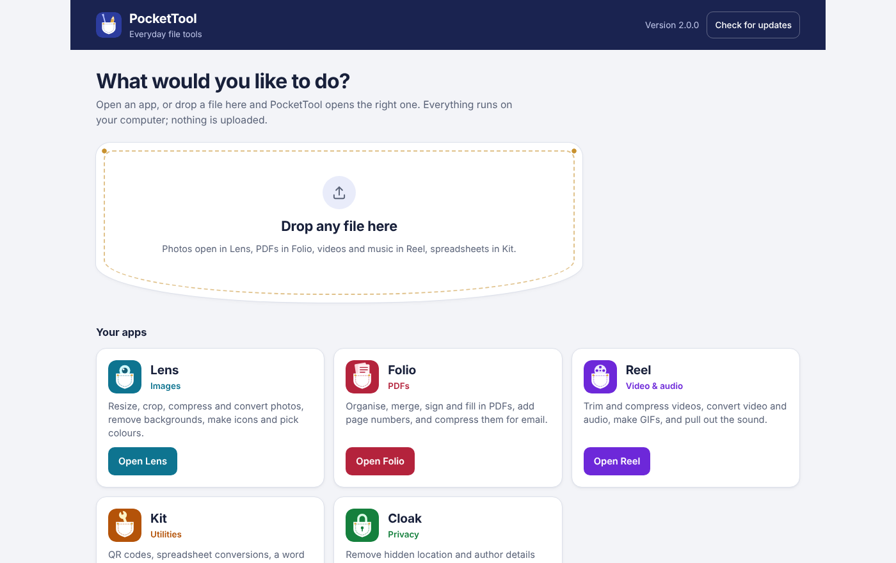
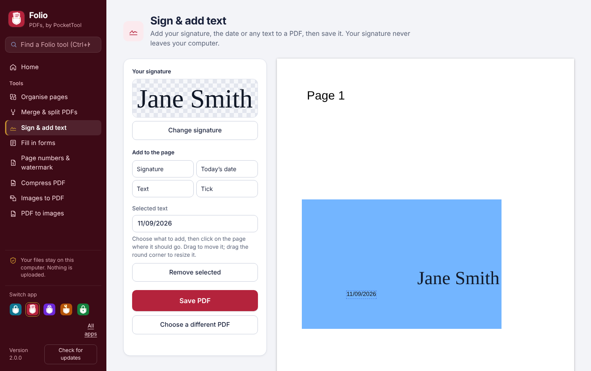

<p align="center"></p>

<h1 align="center">PocketTool</h1>

<p align="center">Everyday file tools that run on your computer: a family of five focused apps, with nothing uploaded.</p>

<p align="center"></p>

## The family

**PocketTool** is the launcher. Open an app, or drop any file on it and PocketTool opens the right app for you.

| App | For | Tools |
| --- | --- | --- |
| **Lens** | Images | Resize & upscale (including AI), batch resize, crop & rotate, remove background (AI), compress to a target size, convert (JPEG, PNG, WebP, HEIC and more), icon maker, colour picker |
| **Folio** | PDFs | Organise pages, merge & split, sign & add text, fill in forms, page numbers & watermarks, compress, images to PDF, PDF to images |
| **Reel** | Video & audio | Trim (instant or frame-exact), compress video (by quality or to a size like 25 MB), convert to MP4, WebM, MP3, M4A or WAV, video to GIF, extract audio |
| **Kit** | Utilities | QR code maker, spreadsheet converter (Excel, CSV, JSON, Markdown), word counter, date calculator with UK bank holidays |
| **Cloak** | Privacy | Remove hidden data (location, camera and author details) from photos and PDFs, password generator |

Each app shows only its own tools, in its own colour. If you drop a file an app doesn't handle, such as a PDF in Lens, it offers to open it in the right app.

<p align="center">
  
  
  
  
</p>

## Private by design

Everything happens on your computer. Your files are never uploaded, there are no accounts, and there's no tracking. The desktop app includes its libraries and video engine, so once it's installed it works without the internet. The only optional connection is to GOV.UK, to check for newly announced bank holidays.

## Download

Get the latest version from the [Releases page](../../releases):

- **Windows**: `PocketTool-Setup-x.y.z.exe` installs the whole family, with a desktop shortcut for PocketTool and a Start menu entry for each app (PocketTool Lens, PocketTool Folio and so on). Each app opens in its own window with its own taskbar icon. `PocketTool-x.y.z-portable.exe` runs without installing.
- **Folio on its own (Windows)**: `Folio-Setup-x.y.z.exe` installs just Folio, the PDF app, as a standalone program with its own Start menu entry, desktop shortcut and taskbar icon. It's small, needs nothing else installed, and checks for Folio updates. `Folio-x.y.z-portable.exe` runs without installing.
- **Linux** (including Bazzite and Steam Deck): `PocketTool-x.y.z.AppImage`. Open it with [Gear Lever](https://flathub.org/apps/it.mijorus.gearlever) to add it to your app menu, or mark it as executable and double-click it. It opens the PocketTool launcher; to start straight in one app, run it with `--app=lens` (or `folio`, `reel`, `kit`, `cloak`).

The first time you open the desktop app, it asks whether to download the **extra packages**: the AI models for Lens's background remover. That's about 670 MB on a computer with a graphics card, or about 270 MB without one, since only the matching versions are downloaded. They're checked against Hugging Face's published fingerprints, kept on your computer, and resume if a download is interrupted. Say "Not now" and Lens asks again when you use the background remover; you can also download or remove them from the **Extra packages** section of the launcher, or **Help > Extra packages…**.

In the desktop app, the **Apps** menu (Ctrl+1 to Ctrl+6) opens any app, and opening an app that's already open brings its window to the front.

The first time you run it on Windows you may see "Windows protected your PC", because the app isn't digitally signed. Click **More info**, then **Run anyway**.

## Updates

Select **Check for updates** at the bottom of the sidebar (or **Help > Check for updates…** in the desktop app). PocketTool compares your version with the latest release on GitHub, shows what's new, and offers the right download for your computer. Your settings are kept when you install a new version. You can also switch on an automatic check once a day; it only asks GitHub for the latest version number.

## Use it in a web browser

Open `app/index.html` in Chrome or Edge. Everything works the same, except that the apps switch in the same tab, and libraries and AI models are downloaded the first time each tool needs them. Add `?app=lens` (or another app's name) to the address to start in that app.

## Build it yourself

You need [Node.js](https://nodejs.org) 20 or newer.

```bash
npm install          # the desktop app tools (a few minutes the first time)
npm run fetch        # the exact libraries, fonts and video engine, into the offline folder
npm test             # checks everything the app needs is there
npm start            # try PocketTool
npm run dist:win     # build the Windows programs into dist/   (on Windows)
npm run dist:linux   # build the Linux AppImage into dist/      (on Linux)
```

The background remover's AI models aren't bundled; the app offers to download them on first use. To bundle them anyway (an installer of about 1.2 GB), use `npm run fetch:full` instead.

On Windows you can also double-click `build.bat` (the family and standalone Folio) or `build-folio.bat` (just Folio), and on Linux run `./build-linux.sh`. To build only Folio from the command line, use `npm run dist:folio`. See [docs/BUILDING.md](docs/BUILDING.md) for step-by-step instructions.

## Releases with GitHub Actions

This repository builds itself. Push a version tag and GitHub builds the Windows and Linux programs and publishes them as a release:

```bash
git tag v1.1.0
git push origin v1.1.0
```

You can also start a build by hand from the **Actions** tab. See [docs/PUBLISHING.md](docs/PUBLISHING.md) for the full walkthrough, including how to put this project on GitHub for the first time.

## How the project is laid out

```
app/index.html               the launcher and all five apps (each app is a mode of the same page)
app/icon.png                 window icon
main.js                      the desktop app: one window per app, menus, offline file serving
preload.js                   lets an app window ask for another app's window, hand it files, and manage extra packages
packages.js                  downloads, checks, resumes and removes the extra packages (AI models)
app/icons/                   each app's window icon
build/app-icons/             each app's Windows icon (for the Start menu and taskbar)
build/installer.nsh          adds the Start menu entry for each app
folio.builder.json           build settings for Folio on its own (Folio-Setup.exe)
offline.js                   maps library, model and font addresses to bundled files
scripts/fetch-offline.mjs    downloads everything into offline/ (run with npm run fetch)
scripts/offline-manifest.json  the list of libraries, models and fonts to bundle
scripts/test-offline.mjs     checks the bundle is complete (npm test)
build/                       program icons for Windows and Linux
.github/workflows/build.yml  automatic builds and releases
docs/                        logo, screenshots and guides
```

## Licences

PocketTool is released under the [MIT licence](LICENSE).

It's built on open-source libraries and models, listed in [THIRD_PARTY_NOTICES.md](THIRD_PARTY_NOTICES.md). **One matters if you plan to use PocketTool commercially:** the "Best quality" and "Standard" modes of Remove background use BiRefNet. Its model and code are MIT licensed, but it was trained partly on the DIS5K dataset, whose terms restrict commercial use. If that's a concern for you, use the "People, quick" mode (MODNet, Apache 2.0), or take legal advice.
